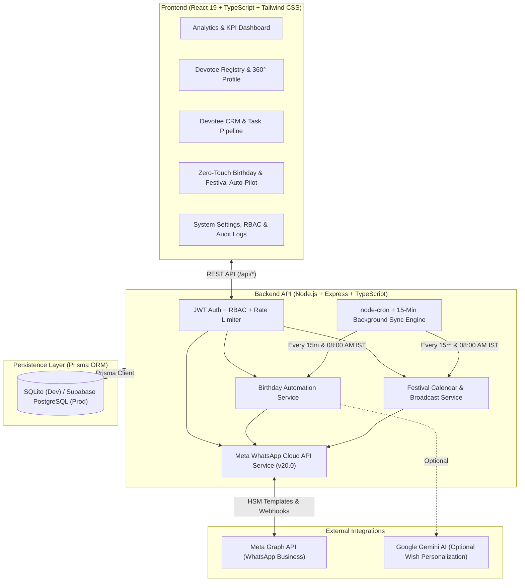

<div align="center">


# ISKCON Shirpur — Devotee & Donor Management System (DMS & CRM)

**A Full-Stack Enterprise Devotee Relationship Management, Automated Seva Receipting & Zero-Touch WhatsApp Cloud API Platform**

[](https://www.typescriptlang.org/)
[](https://react.dev/)
[](https://nodejs.org/)
[](https://www.prisma.io/)
[](https://developers.facebook.com/docs/whatsapp/cloud-api)
[](#automated-testing--verification)

</div>

---

## 📖 Overview

The **ISKCON Shirpur Donor Management System (DMS) & Devotee CRM** is a production-grade full-stack web application built to modernize temple donor stewardship, financial seva tracking, family registry management, and automated devotee engagement.

Designed with a **Zero-Touch Automation Architecture**, the platform eliminates manual administrative overhead by automatically dispatching personalized Hindi/Sanskrit blessings and digital receipts over the **Official Meta WhatsApp Business Cloud API (`v20.0`)** on devotee birthdays, family member birthdays, major Hindu & ISKCON festivals, and upon seva contributions.

---

## ✨ Key Engineering Highlights

### 1. 🤖 Zero-Touch WhatsApp Auto-Pilot Engine
- **Automated Daily Birthday Blessings**: Automatically identifies both **Donors** and **Permitted Family Members** celebrating their birthday (`MM-DD` matching across years) and dispatches personalized Hindi blessings via Meta WhatsApp Cloud API.
- **Smart Family Phone Fallback**: If a family member does not have a separate mobile number on file, the engine automatically routes their personalized blessing (`प्रिय <Family Member Name> जी...`) to the primary donor's WhatsApp number.
- **Automated Hindu & ISKCON Festival Calendar**: Pre-loaded with 8 major festivals (*Sri Krishna Janmashtami, Gaura Purnima, Ram Navami, Radhashtami, Deepotsav / Diwali, Govardhan Puja, Gita Jayanti, Makar Sankranti*) with configurable `YYYY-MM-DD` schedules and per-festival `Auto-Send ON/OFF` toggles.
- **Idempotent Zero-Duplicate Delivery Locks**: Guarantees that neither automatic 15-minute sync runs nor manual admin triggers can ever double-message a devotee or family member within the same calendar year.
- **Dual-Mode WhatsApp Gateway (`MOCK` & `LIVE`)**: Seamlessly switches between local simulation mode (for zero-cost development and testing) and live Meta Graph API (`graph.facebook.com/v20.0`) HSM template/text dispatch with webhook status tracking (`SENT`, `DELIVERED`, `READ`, `FAILED`).

### 2. 🤝 Full-Lifecycle Devotee CRM & Seva Pipeline
- **6-Stage Devotee Stewardship Pipeline**: Tracks progression across `PROSPECT` → `FIRST_TIME` → `REGULAR` → `PATRON` → `LIFE_PATRON` → `LAPSED`.
- **Automatic Tier Classification**: Dynamically computes lifetime contribution tiers:
  - 💎 **Platinum** ($\ge$ ₹11,00,000)
  - 🥇 **Gold** ($\ge$ ₹5,00,000)
  - 🥈 **Silver** ($\ge$ ₹1,00,000)
  - 🪷 **Sudama** ($<$ ₹1,00,000)
- **Follow-Up Task & Interaction Tracking**: Built-in task scheduler with automatic overdue task detection (`HIGH`, `MEDIUM`, `LOW` priorities) and interaction logs (`CALL`, `WHATSAPP`, `EMAIL`, `TEMPLE_VISIT`, `MEETING`).

### 3. 🧾 Instant Seva Donation Recording & Digital WhatsApp Receipts
- Records donations across `UPI`, `CASH`, `BANK_TRANSFER`, `CHEQUE`, `CARD`, and `OTHER` with instant **6-parameter Meta HSM WhatsApp Seva Receipt** generation (`iskcon_seva_receipt_hi`).
- Supports bulk **Excel/CSV Donor Import** (`multer` + `xlsx`) and authenticated **CSV Exports** for Donors, Donations, and Birthdays.

### 4. 🔐 Enterprise Security, RBAC & Audit Trail
- **Role-Based Access Control (RBAC)**: Strict separation between `ADMIN` (full write/broadcast/configuration privileges) and `CHECKER` (read-only verification and CRM interaction logging).
- **Brute-Force Rate Limiting**: IP-based sliding-window rate limiter on `/api/auth/login` returning `429 Too Many Requests` with `Retry-After` headers.
- **Immutable Audit Logging**: Every administrative mutation (donor creation, donation entry, permission change, system setting update) is recorded in the `AuditLog` table with user attribution.

---

## 🏗️ System Architecture



---

## 🛠️ Tech Stack

| Layer | Technologies Used |
| :--- | :--- |
| **Frontend** | React 19, TypeScript, Vite 6, React Router v7, Tailwind CSS, Lucide Icons, Axios, `date-fns` |
| **Backend** | Node.js, Express.js, TypeScript (`tsx`), `node-cron`, `multer`, `xlsx` |
| **Database & ORM** | Prisma ORM, SQLite (Local zero-config), Supabase PostgreSQL (Production schema included) |
| **Security & Auth** | JSON Web Tokens (`jsonwebtoken`), `bcryptjs`, Role-Based Access Control (`ADMIN` / `CHECKER`), Login Rate Limiting |
| **Messaging** | Official Meta WhatsApp Cloud API (`v20.0`), Meta Webhook Verification & Status Callbacks |
| **Testing** | Custom End-to-End Integration & Regression Test Suites (`58/58` automated assertions) |

---

## 📂 Project Structure

```text
iskcon-shirpur-dms/
├── prisma/
│   ├── schema.prisma              # Local SQLite Prisma schema (9 models)
│   ├── schema.supabase.prisma     # Production Supabase PostgreSQL schema
│   ├── supabase_setup.sql         # Direct SQL initialization script for Supabase
│   └── seed.ts                    # Idempotent database seeder with realistic demo data
├── public/
│   └── iskcon-logo.webp           # Official ISKCON Shirpur Lotus-Tilak emblem
├── server/
│   ├── index.ts                   # Express server entry, cron registration & static serving
│   ├── middleware/
│   │   └── auth.ts                # JWT authentication & ADMIN/CHECKER RBAC guards
│   ├── routes/
│   │   ├── auth.ts                # Login (with rate-limiting), logout & session verification
│   │   ├── donors.ts              # Devotee CRUD, category calculation & initial seva intake
│   │   ├── donations.ts           # Seva donation recording & WhatsApp receipt triggers
│   │   ├── family.ts              # Family member CRUD & WhatsApp permission toggles
│   │   ├── birthdays.ts           # Birthday queue, auto-sync & manual trigger endpoints
│   │   ├── festivals.ts           # 8 Hindu/ISKCON festival templates, schedules & broadcasts
│   │   ├── crm.ts                 # CRM tasks, interactions, pipeline stages & manual sync
│   │   ├── whatsapp.ts            # Direct WhatsApp messaging, Meta webhooks & delivery logs
│   │   ├── reports.ts             # Dashboard KPIs, category distribution & analytics
│   │   ├── export.ts              # Authenticated CSV exports (Donors, Donations, Birthdays)
│   │   ├── import.ts              # Bulk Excel/CSV donor & family import
│   │   └── admin.ts               # System settings, user management & audit logs
│   └── services/
│       ├── aiProvider.ts          # Optional Google Gemini AI wish personalization
│       ├── birthdayAutomation.ts  # Automated donor + family birthday WhatsApp engine
│       ├── festivalService.ts     # Automated festival calendar & broadcast engine
│       ├── metaWhatsAppService.ts # Meta Graph API v20.0 client (MOCK & LIVE modes)
│       ├── smsProvider.ts         # Legacy / fallback SMS notification provider
│       └── dataRefreshService.ts  # 15-minute background CRM & messaging sync service
├── src/
│   ├── components/
│   │   ├── IskconLogo.tsx         # Canvas-processed transparent emblem component
│   │   ├── Layout.tsx             # Responsive sidebar, header & role-aware navigation
│   │   └── WhatsAppModal.tsx      # 1-on-1 custom & template WhatsApp composer
│   ├── context/
│   │   └── AuthContext.tsx        # Global JWT session state & 401 auto-logout handler
│   ├── pages/
│   │   ├── Dashboard.tsx          # Executive overview, seva metrics & quick actions
│   │   ├── Donors.tsx             # Devotee directory with tier filters, search & CSV import
│   │   ├── DonorForm.tsx          # New devotee registration + optional initial donation
│   │   ├── DonorProfile.tsx       # 360° devotee view (Donations, Family, CRM, Tasks)
│   │   ├── Donations.tsx          # Seva ledger & one-click WhatsApp receipt resend
│   │   ├── Family.tsx             # Family registry & granular WhatsApp opt-in/out controls
│   │   ├── Birthdays.tsx          # Zero-Touch Birthday & Festival Auto-Pilot hub
│   │   ├── Crm.tsx                # Devotee follow-up task board & pipeline analytics
│   │   ├── Reports.tsx            # Financial & messaging analytics + CSV exports
│   │   ├── Settings.tsx           # Meta WhatsApp API config, automation switches & audit logs
│   │   ├── Users.tsx              # Admin & Checker account management
│   │   └── Login.tsx              # Sacred saffron-themed authentication portal
│   └── services/
│       └── api.ts                 # Axios client with Bearer token & 401 interceptors
└── test/
    ├── api-audit.test.ts          # 42-test E2E API & integration audit suite
    └── regression.test.ts         # 16-test edge-case, security & LIVE WhatsApp regression suite
```

---

## 🚀 Quick Start (Local Development)

### Prerequisites
- **Node.js** `v18+` (or `v20+` recommended)
- **npm** `v9+`

### 1. Clone the Repository
```bash
git clone https://github.com/kunwarsps5455-ui/ISKCON-SHIRPUR-DMS.git
cd ISKCON-SHIRPUR-DMS
```

### 2. Install Dependencies
```bash
npm install
```

### 3. Configure Environment Variables
Copy `.env.example` to `.env` (for local development with SQLite, the default configuration works out of the box):
```bash
cp .env.example .env
```
Ensure `DATABASE_URL="file:./dev.db"` and `WHATSAPP_MODE="mock"` are set in `.env` for instant local execution without external API keys.

### 4. Initialize & Seed the Database
```bash
npx prisma db push
npx tsx prisma/seed.ts
```

### 5. Launch the Application (Frontend + Backend)
```bash
npm run dev
```
- **Frontend UI**: [http://localhost:5173](http://localhost:5173)
- **Backend API**: [http://localhost:5000/api/health](http://localhost:5000/api/health)

---

## 🔑 Default Demo Credentials

| Role | Email | Password | Capabilities |
| :--- | :--- | :--- | :--- |
| **Admin** | `admin@iskconshirpur.org` | `admin123` | Full access: Donor/Donation/Family CRUD, Festival & Birthday Auto-Pilot, CSV Import/Export, WhatsApp Config, User & System Settings |
| **Checker** | `checker@iskconshirpur.org` | `checker123` | Read-only access to Donors, Donations, Family, Reports + CRM Task & Interaction logging |

---

## 🧪 Automated Testing & Verification

This repository includes two comprehensive, zero-mock E2E test suites that exercise the real Express backend and Prisma database across **58 automated test cases**:

```bash
# 1. Type-check the entire frontend & backend codebase
npx tsc --noEmit -p tsconfig.json

# 2. Run the 42-test End-to-End API Audit Suite ( requires server running on :5000 )
npx tsx test/api-audit.test.ts

# 3. Run the 16-test Security, Edge-Case & LIVE Meta HSM Regression Suite
npx tsx test/regression.test.ts

# 4. Verify production bundle build
npm run build
```

### Test Coverage Highlights (`58/58` Passing)
- **Authentication & Security**: JWT issuance, invalid credential rejection (`401`), brute-force rate limiting (`429`), and strict `CHECKER` vs `ADMIN` RBAC enforcement (`403`).
- **Donor & Seva Integrity**: Category tier filtering prior to pagination, `NaN`/negative donation rejection (`400`), and automatic WhatsApp receipt toggling (`AUTO_RECEIPT_ENABLED`).
- **Zero-Touch Birthday & Festival Automation**: Idempotent yearly duplicate prevention, global & per-member family WhatsApp permission enforcement (`ENABLE_FAMILY_MEMBER_MESSAGES`), `MESSAGING_TIME` window checks, and Meta Graph API `v20.0` HSM positional parameter (`{{1}}`..`{{6}}`) verification.

---

## ☁️ Production Deployment (Render + Supabase)

1. **Database (Supabase PostgreSQL)**:
   - Run [`prisma/supabase_setup.sql`](prisma/supabase_setup.sql) in your Supabase SQL Editor or use [`prisma/schema.supabase.prisma`](prisma/schema.supabase.prisma).
2. **Web Service (Render)**:
   - Connect this repository to Render using the included [`render.yaml`](render.yaml) Blueprint.
   - Set `WHATSAPP_MODE="production"` along with your `META_PHONE_NUMBER_ID`, `META_ACCESS_TOKEN`, and `META_WABA_ID` from the Meta Developer Portal.

---

<div align="center">
  <b>Hare Krishna! 🙏 Built with devotion for Sri Sri Radha Gopinath Mandir (ISKCON Shirpur)</b>
</div>
